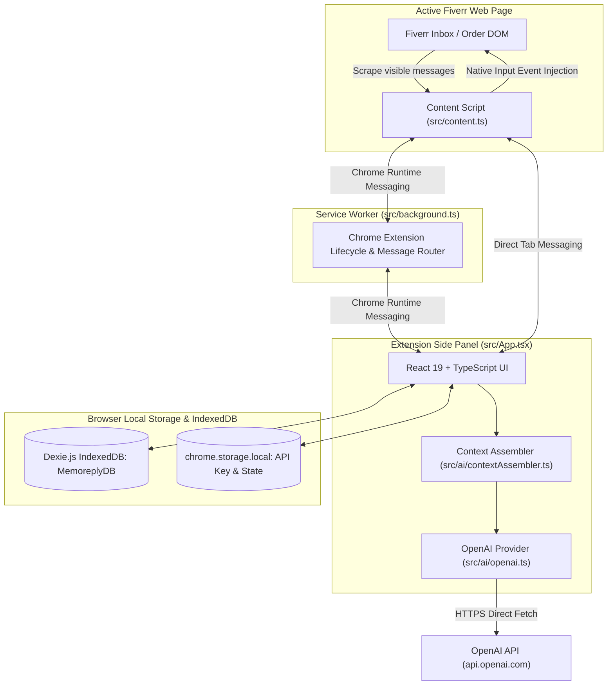

# Memoreply — Architecture Specification

This document details the architectural design, data flow, component interactions, and security standards for **Memoreply**, an AI-powered client memory and reply assistant Chrome extension developed by **HashTurn**.

---

## 1. High-Level System Architecture

Memoreply is built strictly on **Chrome Manifest V3**, using a modular, decoupled architecture where each concern is isolated into clean boundaries:



---

## 2. Core Modules & Responsibilities

### Module 1: Fiverr Integration (`src/content.ts`)
- **Page Context Detection:** Matches URLs against `/inbox/*`, `/messages/*`, and `/manage_orders/*`.
- **DOM Scraping Engine:** Identifies active conversation headers, client avatars, message bubbles, timestamps, and sender roles (`client`, `seller`, `system`).
- **Deduplication:** Computes deterministic hashes based on sender, index, and content snippet to prevent duplicate storage.
- **Safe Draft Composer Injection:** Uses native property setter (`HTMLTextAreaElement.prototype`) to trigger React/Vue internal state updates without auto-submitting messages.

### Module 2: Persistent Client Memory (`src/db/index.ts` & `src/db/repository.ts`)
- **Storage Engine:** Powered by **Dexie.js** wrapping browser `IndexedDB`.
- **Tables:**
  1. `clients`: Stores client ID, handle, display name, avatar, personal notes, tags, and contact timestamps.
  2. `conversations`: Stores conversation IDs, client foreign key, platform URL, and last message timestamps.
  3. `messages`: Stores composite ID (`conversationId_hash`), sender, role, text, timestamp, and extraction time.
  4. `clientFacts`: Stores extracted and manual facts tagged by category (`budget`, `timeline`, `technical`, `preference`, `project`, `general`), with status (`proposed`, `confirmed`, `disputed`) and contradiction flags (`isConflicted`, `conflictReason`).
  5. `sellerKnowledge`: Stores freelancer identity, offered services, core skills, pricing policy, revision policy, and custom guidelines.
- **Deduplication & Heuristics:** Employs `bulkPut` to upsert messages safely and runs regex/rule heuristics to capture initial budget/timeline figures.
- **Contradiction Detection Engine:** Compares incoming proposals with existing stored memory in the same category. If conflicting terms (e.g. altered budget or changed timeline) are detected, facts are flagged with visual warning badges.

### Module 3: Context Retrieval & Assembly Engine (`src/ai/contextAssembler.ts`)
- **Data Aggregation:** Retrieves the active conversation's 15 most recent messages, confirmed client facts, and current seller knowledge base from IndexedDB.
- **Memory Filtering:** Excludes disputed facts and highlights confirmed specifications.
- **Prompt Engineering:**
  - Injects strict policy instructions (e.g. no off-platform contact sharing).
  - Embeds seller's real capabilities and business policies.
  - Naturalizes client memory context so the AI speaks smoothly without robotic phrasing.
  - Applies tone-specific behavioral guidelines.

### Module 4: AI Reply Generator (`src/ai/openai.ts`)
- **Direct API Communication:** Direct `fetch` call to `https://api.openai.com/v1/chat/completions`.
- **ChatGPT Web Session Integration:** Tab-bridge DOM reader / backend polling using exported `auth.json`.
- **Supported Models:** Default `gpt-4o-mini` (cost-effective and rapid), `gpt-4o`, `gpt-3.5-turbo`.
- **Error Handling:** Gracefully captures `401 Unauthorized`, `429 Insufficient Quota / Rate Limits`, and network failures with user-friendly actionable toasts.
- **Connection Testing:** Provides non-destructive lightweight test mechanism (`max_tokens: 1`).

### Module 6: Side Panel User Interface (`src/App.tsx` & `src/index.css`)
- **Tab Layout:**
  - `💬 Chat & Reply`: Main workspace with platform status pill, conversation feed, tone chips, custom directives input, draft editor, and action buttons.
  - `🧠 Client Memory`: Stored client profile, personal seller notes, categorized fact badges, status tags (Proposed, Confirmed, Disputed), and contradiction warning alerts.
  - `📚 Knowledge Base`: Freelancer business name, skills, services, pricing policies, and availability rules.
  - `⚙️ Settings`: ChatGPT authentication mode, live database diagnostics, structured JSON export, and permanent factory reset.
- **Design System:** Custom CSS design system with HSL variables, dark/light theme switching, and accessible typography.

### Module 8: Privacy & Local Data Architecture
- **Local-First Boundary:** All client conversation feeds, memory facts, and seller settings remain strictly within the user's browser `IndexedDB`.
- **Zero Third-Party Middlewares:** Data is never relayed through external proxies.
- **Data Portability:** User can export their full dataset as a structured JSON backup.
- **Factory Reset Guarantee:** Completely clears both `MemoreplyDB` and `chrome.storage.local` with strict confirmation warning.

### Module 10: Automated Testing Architecture
- **Unit Testing (Vitest):**
  - Deduplication & Deterministic Hashing (`tests/unit/deduplication.test.ts`)
  - Context Retrieval & Assembly Engine (`tests/unit/contextAssembler.test.ts`)
  - Memory Conflict & Contradiction Detection (`tests/unit/memoryConflict.test.ts`)
- **End-to-End Testing (Playwright):**
  - Side Panel smoke and DOM integrity tests (`tests/e2e/extension.spec.ts`)

---

## 3. Data Schema & Models

```typescript
// Client Fact Status
type FactStatus = 'proposed' | 'confirmed' | 'disputed';

// Client Fact / Memory
interface ClientFactEntity {
  id: string;
  clientId: string;
  category: 'budget' | 'timeline' | 'technical' | 'preference' | 'project' | 'general';
  fact: string;
  status: FactStatus;
  isConflicted?: boolean;
  conflictReason?: string;
  source: 'extracted' | 'manual';
  sourceMessageId?: string | null;
  createdAt: string;
  updatedAt: string;
}

// Seller Profile / Knowledge Base
interface SellerKnowledgeEntity {
  id: string; // 'default_seller'
  businessName: string;
  roleTitle: string;
  professionalIntro?: string;
  servicesOffered: string[];
  coreSkills: string[];
  pricingPolicy: string;
  revisionPolicy: string;
  communicationHours: string;
  customRules: string;
  updatedAt: string;
}
```

---

## 4. End-to-End Data Flow

```
1. USER CLICKS REFRESH / AUTO-MUTATION
   │
   ▼
2. CONTENT SCRIPT SCRAPES FIVERR DOM
   ├── Extracts messages, sender roles, timestamps, client handle
   └── Sends ConversationData to Side Panel
   │
   ▼
3. REPOSITORY PERSISTS DATA TO DEXIE (IndexedDB)
   ├── Finds or creates Client record
   ├── Upserts messages with bulkPut (deduplication)
   └── Detects candidate facts (budget, timeline, tech)
   │
   ▼
4. USER SELECTS TONE & CLICKS "GENERATE REPLY"
   │
   ▼
5. CONTEXT ASSEMBLER QUERIES INDEXEDDB
   ├── Fetches recent 15 conversation messages
   ├── Fetches confirmed client memory facts
   ├── Fetches seller profile & knowledge base
   └── Assembles systemPrompt and userPrompt
   │
   ▼
6. OPENAI PROVIDER CALLS API
   └── Sends direct HTTPS request to api.openai.com
   │
   ▼
7. GENERATED TEXT RENDERED IN DRAFT COMPOSER
   │
   ▼
8. USER REVIEWS DRAFT & CLICKS "INSERT INTO FIVERR"
   ├── Content script receives INSERT_DRAFT message
   ├── Native input event dispatches text into composer
   └── Composer focused for seller to manually submit
```

---

## 5. Security, Privacy & Compliance Guidelines

1. **Local-First Privacy:** All sensitive freelance client communications and memories remain on the user's local machine in browser IndexedDB.
2. **Zero Auto-Send Guarantee:** The extension strictly inserts drafts into the input element and focuses it. It NEVER clicks the "Send" button or dispatches form submits automatically.
3. **Fiverr Policy Compliance:** System prompts strictly forbid including phone numbers, WhatsApp, Telegram, personal email addresses, or off-platform payment methods.
4. **Direct API Transport:** No proxy servers or cloud middle-layers intercept the user's OpenAI API key or client messages.
